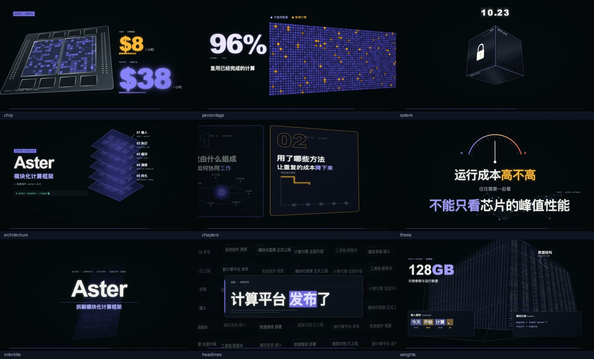

# 科技透视动效视频模板

一套可供 AI 持续制作的 Remotion 工程。保留透视运镜、计数器、扫描网格、立方体组装、分层拆解、章节卡片、仪表命题、新闻飞掠、参数矩阵等镜头语言，默认 60 秒、无配音、程序合成音效。画面由 React/SVG/Canvas/CSS 完成，无需 AE。



## 模板用途与适用场景

适合科技科普、系统架构、计算效率、产品机制和数据解说。9 类动效场景加实际媒体场景，文案、数字、标注、镜头顺序、时长、画幅、字幕、声音与封面选景从 content.json 控制。可复制同类镜头并使用不同参数。

模板提供固定镜头语言。全新产品外观、人物、精密机械或其他视觉隐喻仍需 AI 适配素材/组件。仅换标题不能完成所有主题的视觉改编。默认 Aster 是虚构概念演示，数字不是事实数据。

## 模板中心卡片与工程元数据

制作流程继续读本文件的工程字段（`id`、`name`、`engine`、`entrypoints`、`paths`、`capabilities` 等）。模板中心卡片只认 `aivio.title`、`aivio.description`、`aivio.cover`。产品不会把工程字段 `name` 当作卡片标题，也不会用工程 `description` 代替 `aivio.description`。

工程 `schema_version` 为 `"2.0"`，表示本模板带有 `component-catalog.json`。它与 `content.json` 的 `schemaVersion`（仍为 `"1.0"`，场景仍是 kind + data）无关，也与卡片协议无关。

| 缺失 | 模板中心行为 |
| --- | --- |
| 无 `aivio.title` 或为空 | 标题「未命名模板」；副标题仍为 owner/repo；不过滤出列表 |
| 无 `aivio.description` | 「无简介」；不过滤 |
| 无 `aivio.cover` 或封面文件不存在 | CSS 占位；不过滤 |

根目录 `cover.png` 与 `aivio.cover` 一致。`reference_files.cover` 仍是风格参考图，不是卡片封面真源。

`speech_semantic_alignment` 与 `automatic_voiceover_generation` 仍是 `not_implemented`。拆分场景和组件目录没有实现配音语义对齐或自动配音，也没有通用 JSON 视频 DSL 或全局 Skill。

## 素材要求

可只给主题与文字，也可附配音、图片或视频，不要求全部齐全。图片和视频会实际加载；视频素材默认静音。自带音频无需 API Key；程序音效由 Node 标准库生成，并随场景顺序与时长重建。没有旁白生成、自动转写、语义对齐或人声分离。

## 默认交付

- 横屏 1920×1080 或竖屏 1080×1920 的 MP4。
- 1600×1200、1200×1600、1920×1080 三张 PNG 封面，各自排版。
- 本地工作区的预览、技术报告与可继续修改的本期工程。

竖屏采用上方主题、中间完整结构舞台、下方解释的布局。舞台内部小标签会缩小；重要结论需写入竖屏标题/说明，特写构图可继续按本期需要调整。

## 制作入口

将仓库交给 AI，说：

> 使用 make-video，为「我的主题」制作一条 60 秒横屏视频，无配音，添加程序音效，并输出三张封面。

AI 读取 [AGENTS.md](AGENTS.md) 和 [make-video](.agents/skills/make-video/SKILL.md) 后连续制作。手动命令：

```bash
python3 .agents/skills/make-video/scripts/pipeline.py env
python3 .agents/skills/make-video/scripts/pipeline.py init --install
# 编辑 work/project/content.json
python3 .agents/skills/make-video/scripts/pipeline.py check
python3 .agents/skills/make-video/scripts/pipeline.py preview --frames 0-59
python3 .agents/skills/make-video/scripts/pipeline.py render
python3 .agents/skills/make-video/scripts/pipeline.py verify
```

可选的组件完整性检查（不替代上面七个命令；catalog / registry / 引用路径不合法时退出码 5）：

```bash
python3 .agents/skills/make-video/scripts/pipeline.py inspect
```

运行环境：Node.js 22+、npm、Python 3.10+、FFmpeg/ffprobe、Chrome 与中文字体。锁文件固定 Remotion 4.0.538。第一次 init --install 需要下载 npm 依赖；不需要任何付费服务。

初始仓库没有 work/，开始制作才生成，重复初始化保留修改。输出在 work/delivery，实际参数在 work/project/content.json。详细参数和媒体用法见 [制作命令](.agents/skills/make-video/references/remotion.md)，任务恢复见 [状态说明](.agents/skills/make-video/references/task-state.md)。

## 验证范围

已完成完整默认 60 秒横屏渲染、改主题的竖屏短片、真实图片/视频输入、外部音轨测试、静音分支和三种全尺寸封面渲染；技术检查包括合成加载、类型、时序、尺寸、帧率、音轨、完整解码与产物指纹。视觉抽查和未完成的听觉验收分别记录在 [模板说明](.agents/skills/make-video/references/template.md)。外部音轨技术测试使用测试音，不代表完成了真实旁白的语义对齐。

GitHub 保留源码、必要素材、参考图片和一段程序音效参考；不附带示例成片 MP4、原片、原配音、运行区、依赖或缓存。维护结构与隔离测试见 [architecture.md](docs/architecture.md)。
